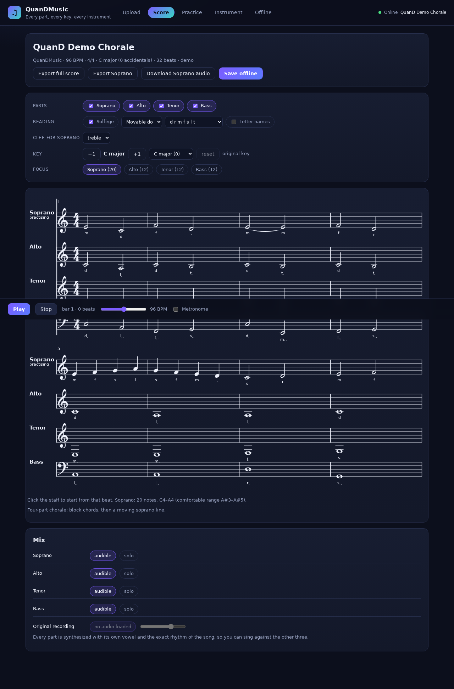
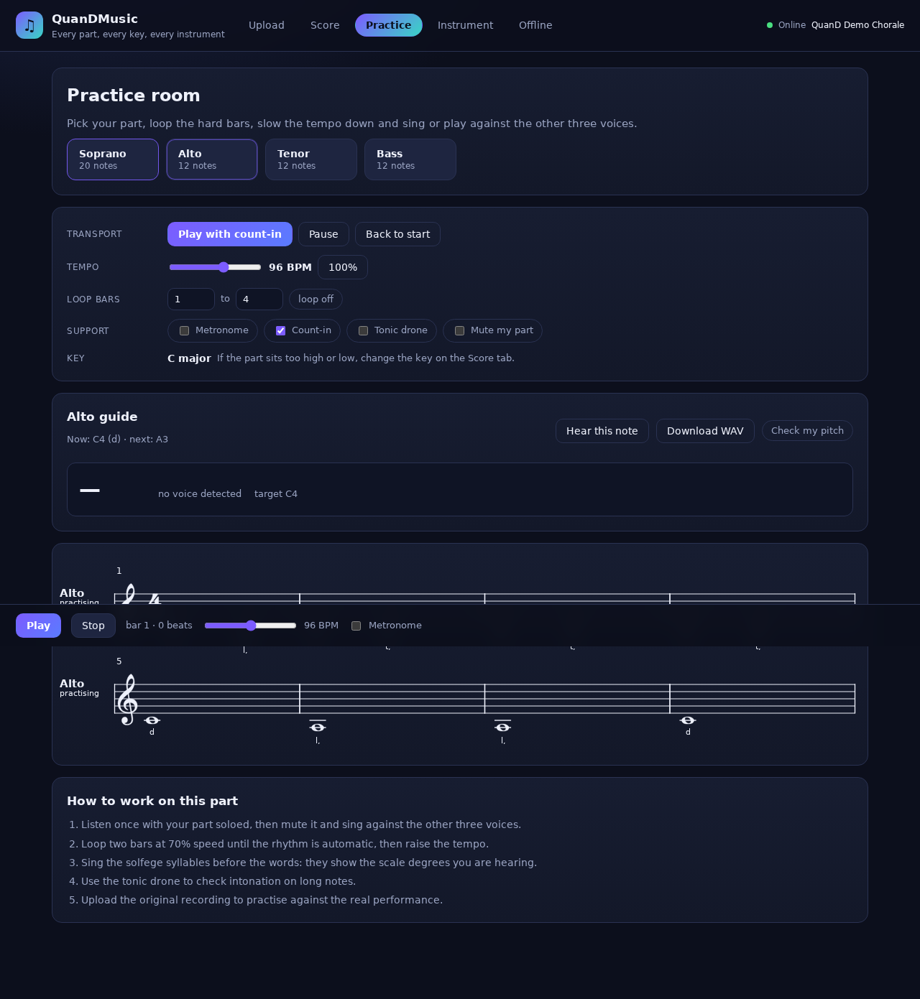
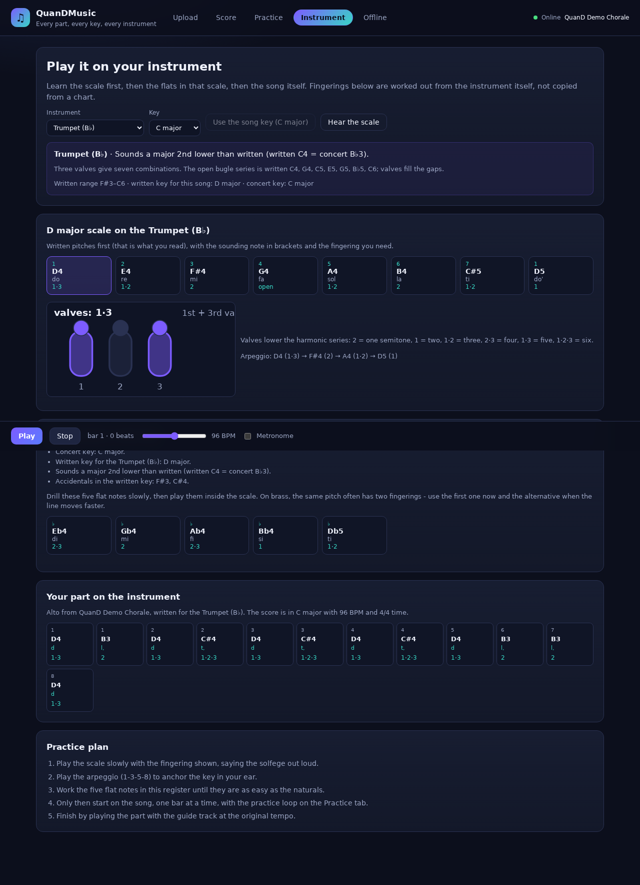
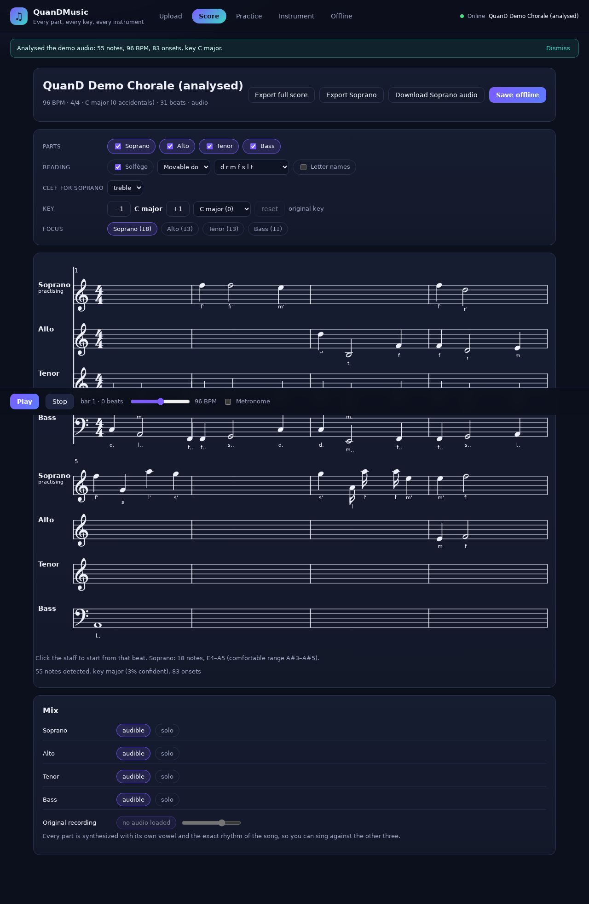

# QuanDMusic

**Split any song into Soprano, Alto, Tenor and Bass, read it as solfège, transpose it to a key that suits you, and learn to play your part on your own instrument - with or without a connection.**

QuanDMusic is a single-page, offline-first music platform. Everything (analysis, engraving, playback, practice tools) runs in the browser on your device; nothing is uploaded anywhere.

---

## What it does

### 1. One song in, four parts out
* **Audio upload** (mp3, wav, m4a, ogg, ...) is decoded locally and analysed with a purpose-built DSP pipeline:
  spectrogram -> harmonic/percussive separation (median-filter HPSS) -> onset detection -> tempo and beat grid ->
  harmonic-salience multi-pitch detection -> quantisation to the beat grid -> voice-leading assignment to SATB.
* **MIDI** (formats 0, 1, 2) is parsed from the bytes, with tempo, time signature and key-signature meta events.
* **MusicXML** (`score-partwise`) is read with a small built-in XML parser: divisions, chords, rests, ties, backup/forward, clefs.
* Whatever the source, the result is one score model with four monophonic voices, real note lengths and a key.

### 2. Read it the way you want
* Solfège in the short form you asked for (**d r m f s l ti do**) or the full syllables, **movable do** (tonic = do) or **fixed do** (C = do), with octave marks (`d'`, `t,`).
* Letter names as an alternative.
* **Clefs**: treble, alto, tenor or bass per part - change the clef of a part and the notes move to the right lines.
* A real engraved staff (VexFlow) with key signatures, time signatures, accidentals, dots, beams, ties and a playback cursor.

### 3. A key that fits your voice
* Transpose the whole score (and its key signature) by semitones; the spelling follows the new key (B♭ major, never A♯ major).
* Transposition keeps the exact rhythm, tempo and part-writing.

### 4. Hear the part in the exact tempo and rhythm
* Each part is synthesised with a formant voice model, so the guide track carries pitch, vowel and the true rhythm.
* Per-part mute / solo, original-recording mix, metronome, count-in, tempo from 40% to 140%, bar loops, tonic drone.
* Export any part as **WAV** or as **MusicXML** for a music stand or a notation app.

### 5. Learn your instrument through the key
* 19 instruments with the correct transposition, written range and clef.
* **Brass fingerings are computed from the instrument's harmonic series**, not hard-coded: trumpet/cornet/flugelhorn/horn/euphonium valve combinations (open, 2, 1, 1·2, 2·3, 1·3, 1·2·3) and the seven trombone slide positions, with alternative fingerings.
* Guitar fret positions in standard tuning, piano key positions, and clear written-vs-sounding pitch for every transposing instrument.
* For each key: the scale in written pitch with solfège, the arpeggio, and a **flat drill for the five flat notes** - the exact thing you need when a new key introduces B♭, E♭, A♭, D♭ and G♭.
* Then the same for **your part of your song**, note by note, with the fingering for each note.

### 6. Offline by design
* Service worker caches the app shell and every asset after the first visit.
* Projects are stored in IndexedDB; the analyser runs in a Web Worker with no network access.
* No fonts, samples or models are fetched at runtime - the engraver, synthesiser and analysis are all bundled.

---

## Getting started

```bash
npm install
npm run dev        # http://localhost:5173
npm run build      # production build in dist/ (open it from any static server)
npm run preview    # serve the production build
npm test           # 63 unit / integration tests
```

End-to-end check in a real browser (optional, needs `npx playwright install chromium`):

```bash
npm run build && npx vite preview --port 4173 &
npm run test:e2e   # 17 checks: engraving, playback, analysis worker, offline reload
```

### Screenshots

| | |
| --- | --- |
|  |  |
|  |  |

No API keys, accounts or servers are required.

### Try it in 30 seconds
1. Open the app and press **Open the demo chorale** (four-part SATB score, C major, 96 BPM).
2. On the **Score** tab, switch between solfège styles, change the clef, transpose the key.
3. Press **Play** in the bottom bar: every part sings its own line in the exact rhythm.
4. On the **Practice** tab choose a voice, set a bar loop, slow it down, mute your part and sing along. **Check my pitch** uses the microphone.
5. On the **Instrument** tab pick the trumpet or the trombone, look at the scale with real fingerings, then the flats drill, then your part of the song.
6. Press **Analyse a synthesized performance** on the Upload tab to run the full audio pipeline on a rendered performance of the demo (no file needed).

---

## Architecture

```
src/
  core/            pure music theory, no browser APIs
    pitch.ts       MIDI <-> frequency <-> spelled pitch
    keys.ts        key signatures, diatonic spelling, transposition
    solfege.ts     movable/fixed do, short and full syllables, octave marks
    score.ts       Score / Part / NoteEvent model, note values, bar splitting
    voices.ts      SATB assignment by dynamic programming
    keydetect.ts   Krumhansl-Schmuckler key finding
    quantize.ts    rhythm quantisation and rhythm templates
    instruments.ts transposition, ranges, clefs, tuning
    fingerings.ts  valve/slide/fretboard/keyboard engines + practice generators
    musicxmlExport.ts  full score and single-part export
    demo.ts        built-in demo chorale
  dsp/             pure signal processing (typed arrays only)
    fft.ts         radix-2 FFT, spectrogram, resampling, normalisation
    hpss.ts        median-filter harmonic/percussive separation
    onsets.ts      spectral flux, adaptive peak picking
    tempo.ts       autocorrelation tempo, comb-filter beat grid
    multipitch.ts  spectral-peak harmonic salience, note tracking, chroma
    pitchdetect.ts autocorrelation pitch for the microphone
    analyze.ts     the whole pipeline in one pure function
    analyze.worker.ts / analyzeClient.ts   worker wrapper with fallback
  import/          midi.ts, musicxml.ts, xml.ts
  audio/           player.ts (Web Audio), voiceSynth.ts, wav.ts, mic.ts
  render/          layout.ts (pure), vexHelpers.ts, ScoreView.tsx (VexFlow)
  state/           ui.ts, idb.ts
  components/      ImportPanel, ScorePanel, ScoreControls, PracticePanel,
                   InstrumentPanel, InstrumentDiagram, OfflinePanel
```

Key design decisions:

* **Pure cores.** `src/core` and `src/dsp` never touch the DOM, so they are unit-tested directly in Node with synthetic audio and hand-written MIDI/MusicXML fixtures.
* **Analysis in a worker.** The pipeline copies the mono signal into a module worker; if workers are unavailable it falls back to the main thread.
* **Engraving is decoupled from playback.** The cursor is a single SVG rectangle updated per frame; the score is only re-engraved when the notes, clef, key or reading system change.
* **Brass fingerings are derived, not stored.** Given a fundamental and a valve/slide offset, every note is a harmonic; this reproduces the standard charts exactly (verified in tests for the whole trumpet and trombone range).

---

## Verification

`npm test` runs 63 tests covering:

| Area | What is checked |
| --- | --- |
| Pitch, keys, solfège | circle of fifths, spelling of awkward keys (E♭, F♯, A minor), movable/fixed do, octave marks, chromatic syllables |
| Score model | bar lengths, note values, chord grouping, bar-line splitting, transposition |
| Instruments | transposition maths, **standard trumpet valve chart (23 notes)**, **standard trombone slide positions**, scale generation, flats drill |
| MIDI import | tempo/time/key meta events, note timing, four-track SATB mapping, format-0 channel splitting |
| MusicXML import | parts, chords, rests, ties, divisions, clefs, metadata |
| Export | MusicXML round trip (score -> file -> score is identical, including ties over bar lines), single part export |
| DSP | FFT peak frequency, resampling, HPSS separation, 120 BPM detection, four-note chord transcription |
| Full pipeline | synthesised demo performance -> tempo, key and four non-empty parts |
| UI | app renders, demo loads, score engraves (SVG paths), all five tabs work, cursor follows the beat, transposition changes pitches |
| Spelling | every pitch class in seven keys spells back to the right MIDI note with at most one accidental |

---

## Honest limits

* **Audio separation is heuristic, not a neural separator.** The pipeline extracts the strongest pitched lines and assigns them to SATB; a dense mix with drums, reverb and overlapping voices will produce a workable but imperfect transcription. MIDI and MusicXML imports are exact.
* **No lyric transcription** in this version - the guide tracks sing vowels, not words.
* **Wind and string fingerings are not invented.** For instruments where a fingering depends on embouchure or on which of several keys you press (flute, clarinet, sax, violin family), the app shows written pitch, transposition, range and the practice plan instead of made-up fingerings. Brass valve/slide positions, guitar frets and piano keys are exact.
* **Compressed MusicXML (`.mxl`) is not unzipped**; export the uncompressed `.musicxml` instead.
* **Tempo is assumed constant** within a file: the MIDI importer reads the first tempo event and audio analysis reports one tempo (with a beat grid).

---

## Privacy

Files are decoded and analysed in the browser. Projects and settings live in IndexedDB on your device. There is no backend, no telemetry and no third-party request at runtime.

## Licence

MIT (see LICENSE).
